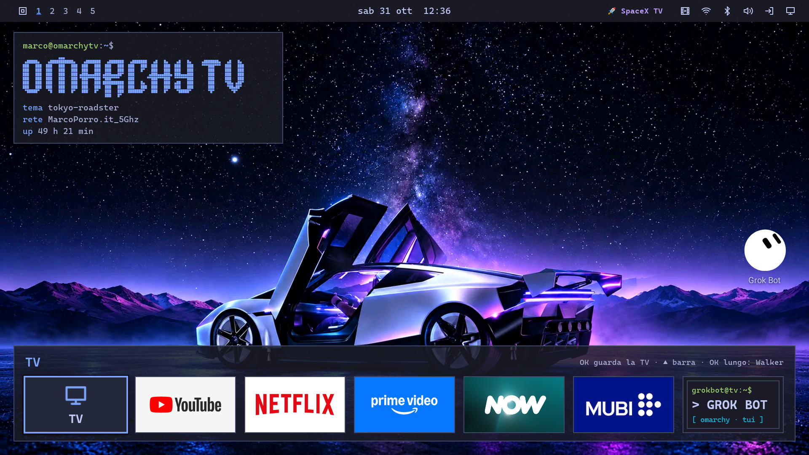

# OmarchyTV

**An Omarchy-style home screen for Android TV, featuring a native Omarchy TUI Grok Bot assistant, 32 MIT themes with TV wallpapers, a desktop link to your Omarchy PC / Mac, a native MCP server, and an Android smartphone wireless installer.**

Created by **[Marco Porro](https://www.marcoporro.it)** ([x.com/MarcoPorro](https://x.com/MarcoPorro) · [www.marcoporro.it](https://www.marcoporro.it))

Official Synchronized Repositories: **[GitHub (`github.com/piermark/omarchytv`)](https://github.com/piermark/omarchytv)** · **[GitLab (`gitlab.com/piermark/omarchytv`)](https://gitlab.com/piermark/omarchytv)**

Published: **31 October 2026 (latest release)** · Version **2.13.8** (`versionCode 25` — Android TV, PC/Mac Plugin & Mobile Companion) / **2.13.8** (LG webOS) & **2.13.8** (Samsung Tizen), experimental · Cinemarchy **0.1.0-alpha** · License **MIT**

> [!WARNING]
> **BETA SOFTWARE: THINGS MAY NOT WORK.** OmarchyTV has been tested on several devices (Sony KD-55XE9005 on Android 9,
> Google TV Streamer on Android 14, Sharp AQUOS, Noblex/Hisense on Android 11) plus the Android TV emulator. Expect rough edges, missing features on some TVs and bugs. It never roots or uninstalls
> anything, and you can always switch back to the stock home screen (see [INSTALL](launcher/docs/INSTALL.md)), but use it at your own risk.



*OmarchyTV 2.13.8 on my Sony BRAVIA: Tom Ballard's ([@tcballard](https://x.com/tcballard)) Tokyo Roadster theme and wallpaper (MIT, see [Credits](#credits-and-third-party-software)), Grok Bot companion and the SpaceX TV plugin by Simon Loffler ([@sighmon](https://x.com/sighmon)).*

**Animated wallpapers come alive when you open the launcher or press Home** (artwork and animations by [Erik Johansson](https://github.com/erikrjohansson), MIT). Click a frame to play the clip:

| Eyes Wide (Last Horizon) | Cumulus: Airship | Cumulus: Lighthouse |
|---|---|---|
| [](https://github.com/piermark/omarchytv/raw/main/docs/media/webos-home-eyes-wide.mp4) | [](https://github.com/piermark/omarchytv/raw/main/docs/media/webos-home-cumulus-airship.mp4) | [](https://github.com/piermark/omarchytv/raw/main/docs/media/webos-home-cumulus-lighthouse.mp4) |

| Workspace 2 · TV | Workspace 4 · PC | Workspace 5 |
|---|---|---|
|  |  |  |
| **Logo menu** | **Screensaver (tte effects)** | **Workspace 3** |
|  |  |  |

*Screenshots from the Android TV emulator (API 28, 1920×1080, English UI). The app
tiles (Netflix, Prime Video, YouTube, CHILI, RaiPlay) are the real app icons captured on a Sony KD-55XE9005 running
OmarchyTV; see [Trademarks](#trademarks).*

---

## Release Downloads & Checksums (`v2.13.0-beta`, pre-release)

I sign every Android APK with the OmarchyTV release certificate (`SHA-256: 90aa68d9f45e623eadfd349ab1eb66042356f95ff6347a4568c3f3a78f8ea33d`), so `adb install -r` upgrades over `2.12.0-beta` and keeps your settings. All checksums are also in `SHA256SUMS` on the release.

| Artifact | Download | Platform | Version | Size | SHA-256 |
|---|---|---|---|---|---|
| **`omarchytv-release-2.13.0-beta.apk`** | **[GitHub](https://github.com/piermark/omarchytv/releases/download/v2.13.0-beta/omarchytv-release-2.13.0-beta.apk)** · **[GitLab](https://gitlab.com/piermark/omarchytv/-/releases/v2.13.0-beta)** | Android TV / Google TV / Fire OS (`com.omarchytv.home`, `minSdk 24`, `targetSdk 34`) | `2.13.0-beta` (`versionCode 21`) | `8.2 MB` | `53d88d14ffad8933048570e7ae324d11bba0907ff0a8252ad142eb6ac564b2ea` |
| **`omarchytv-webos-2.13.2-testing.ipk`** | **[GitHub](https://github.com/piermark/omarchytv/releases/download/v2.13.2-testing-webos-tizen/omarchytv-webos-2.13.2-testing.ipk)** · **[GitLab](https://gitlab.com/piermark/omarchytv/-/releases/v2.13.2-testing-webos-tizen)** | LG webOS TV (`com.omarchytv.home`, experimental) | `2.13.2-testing` | `6.1 MB` | `6f8782375bf22ed9899f82293d9d58cfe31561836b6acee699581c908b8bd6e8` |
| **`OmarchyTV-tizen-2.13.6-testing-unsigned.wgt`** | **[GitHub](https://github.com/piermark/omarchytv/releases/download/v2.13.2-testing-webos-tizen/OmarchyTV-tizen-2.13.6-testing-unsigned.wgt)** · **[GitLab](https://gitlab.com/piermark/omarchytv/-/releases/v2.13.2-testing-webos-tizen)** | Samsung Tizen TV (unsigned testing build, sign it in Tizen Studio; see [INSTALL-TIZEN.md](tizen/INSTALL-TIZEN.md)) | `2.13.6-testing` | `6.5 MB` | `f08c4ba27df84a1f0a3846f182f610c1cf1b3c30eae6989535ad7f10805408d8` |
| **`omarchytv-mobile-2.13.0-beta.apk`** | **[GitHub](https://github.com/piermark/omarchytv/releases/download/v2.13.0-beta/omarchytv-mobile-2.13.0-beta.apk)** · **[GitLab](https://gitlab.com/piermark/omarchytv/-/releases/v2.13.0-beta)** | Android phone installer & companion (`com.omarchytv.mobile`, `minSdk 26`) | `2.13.0-beta` (`versionCode 21300`) | `177 KB` | `e45a5c0f7ccd662279d34e80ffbf4e9581061603012e8814e5941e8909b67f79` |
| **`omarchy-tv-pc-plugin-2.13.0-beta.tar.gz`** | **[GitHub](https://github.com/piermark/omarchytv/releases/download/v2.13.0-beta/omarchy-tv-pc-plugin-2.13.0-beta.tar.gz)** · **[GitLab](https://gitlab.com/piermark/omarchytv/-/releases/v2.13.0-beta)** | Omarchy Linux / macOS (`omarchy-tv` + `omarchy-link`) | `2.13.0-beta` | `221 KB` | `968c5ffb79f5b88254df6ff922888027c1776c49bcf154980f1427c3338521bf` |
| **`omarchy-tv-2.13.0-beta.tar.gz`** | **[GitHub](https://github.com/piermark/omarchytv/releases/download/v2.13.0-beta/omarchy-tv-2.13.0-beta.tar.gz)** · **[GitLab](https://gitlab.com/piermark/omarchytv/-/releases/v2.13.0-beta)** | PC plugin `omarchy-tv` only | `2.13.0-beta` | `53 KB` | `620641f5f6c2448b4288f472cac2f09a3b870b8a08f8a7fec22344802fe99271` |
| **`omarchy-link-2.13.0-beta.tar.gz`** | **[GitHub](https://github.com/piermark/omarchytv/releases/download/v2.13.0-beta/omarchy-link-2.13.0-beta.tar.gz)** · **[GitLab](https://gitlab.com/piermark/omarchytv/-/releases/v2.13.0-beta)** | PC plugin `omarchy-link` only | `2.13.0-beta` | `168 KB` | `e788142beb048c66d103fd013a688b4c5b590cdda7b917aac2b5514c0af0eb5a` |

All releases are on **[GitHub Releases](https://github.com/piermark/omarchytv/releases)** and **[GitLab Releases](https://gitlab.com/piermark/omarchytv/-/releases)**. Full notes: **[CHANGELOG.md](CHANGELOG.md)**. Previous release: [v2.12.0-beta](https://github.com/piermark/omarchytv/releases/tag/v2.12.0-beta).

---

## See it in action (`2.13.0-beta`)


*The new default screensaver, my Aquarium homage to Future Crew's* Second Reality *(all code, art and audio are mine).*

**🔊 [Watch the screensaver with sound (MP4, 0.9 MB)](https://github.com/piermark/omarchytv/releases/download/v2.13.0-beta/omarchytv-aquarium-demo-with-sound.mp4)** · [view in the repo](https://github.com/piermark/omarchytv/blob/main/docs/media/aquarium-homage-demo.mp4)

<video src="https://raw.githubusercontent.com/piermark/omarchytv/main/docs/media/aquarium-homage-demo.mp4" controls width="720"></video>

| Android TV · Home | Android TV · Cinemarchy 0.1.0-alpha | Android TV · Grok Bot Companion |
|---|---|---|
|  |  |  |
| **LG webOS · Home** | **LG webOS · Cinemarchy** | **LG webOS · Plugins** |
|  |  |  |
| **Aquarium (homage, default)** | **Aquarium Classic** | **Samsung Tizen · Companion** |
|  |  |  |

*Android screenshots come from the Android TV emulator (API 28, 1920×1080). webOS and Tizen screenshots come from the web app in headless Chrome with a Tizen shim, not from a real TV.*

---

## What's New in `2.13.2-testing` (LG webOS) / `2.13.6-testing` (Samsung Tizen)

One shared web app, two version numbers: the Samsung widget is numbered 2.13.6 so it installs over the earlier 2.13.5 test widget. Release: [GitHub](https://github.com/piermark/omarchytv/releases/tag/v2.13.2-testing-webos-tizen) · [GitLab](https://gitlab.com/piermark/omarchytv/-/releases/v2.13.2-testing-webos-tizen).

- **Bigger text on LG webOS and Samsung Tizen:** launcher text can now be enlarged on both TVs from **Settings > System > Text size**: Small 90%, Normal 100% (default), Large 115% and Extra large 130%. It applies to the whole launcher, it is saved across restarts, and it is translated in English, Italian and German.
- **Crisp Cinemarchy and OMARCHY logos:** the block-art logos are now drawn as vector graphics, so they stay sharp at 1080p and 720p.
- **Lighter screensaver on Samsung:** on Tizen the Aquarium renders at half resolution (it still fills the screen), thanks to the first Samsung test by Wes (@wesleygrimes, #60). webOS stays at full resolution.
- **Samsung Tizen improvements** by @fraction12 (#61): installed-app discovery with native artwork, and real TV/HDMI source switching.
- **Smoother Aquarium screensaver** by @jdtimothy: fewer pauses and audio dropouts, fixed End Credits (#62), and the ducks no longer teleport (#63).

## What's New in `2.13.0-beta` (`versionCode 21`, pre-release)

- **Default Aquarium screensaver: "asciiquarium × Second Reality" homage + 4-channel tracker audio:** the default screensaver (`saverArt = "aquarium"`, sound on by default, `M` toggles mute) is now a small demo in five parts that loop: **Surface** (ship with OMARCHY on the hull, whale and spout, ducks), **Descent**, **Mid waters** (porthole lens, copper bars, the moving OMARCHY castle), **Abyss** (translucent glenz vector, angler fish, leviathan) and an **end credits** scroller with greetz. Many fish species swim in depth lanes with parallax, fish breathe bubbles, and a shark eats fish. The depth header and the right ruler show the same depth. The palette comes from the current Omarchy theme. Audio is my own 4-channel tracker-style tune at 48 kHz stereo, with tracker panning (L R R L), click-free envelopes, per-part variations, an ambient abyss, and VU meters fed by the real channel levels. For burn-in, the whole picture shifts a few pixels slowly, the HUD fades in and out, and nothing stays still. Rendering is capped at 30 fps.
- **Aquarium Classic:** the previous Cyber-TUI Aquarium, with its look and its original ST3 tune, is still available as **Aquarium Classic** (`saverArt = "aquarium-classic"`) in the screensaver picker on Android TV, webOS and Tizen. I only fixed its bugs: full OMARCHY logo, no overlapping text (the ST3 line has its own row; ticker, copper bar and scroller no longer collide), dim sonar column behind the fish, and anti burn-in pixel shift + HUD fade.

  > **A personal homage:** I made the ASCII Aquarium as my personal homage to the 1990s demoscene and to Future Crew's *Second Reality* (1993). All of the code, graphics and audio are original. Nothing was taken from their demo. The fish-tank idea is inspired by [asciiquarium](https://robobunny.com/projects/asciiquarium/) by Kirk Baucom (GPL); no code or art from it was copied, every sprite was drawn from scratch. — Marco Porro

- **Default `last-horizon` ("Eyes Wide") Animated Intro + Random Theme/Wallpaper Toggles:** Starts on **`last-horizon`** (`01-eyes-wide.webp` + `01-eyes-wide.mp4`, artwork by **Erik Johansson** `@erikrjohansson`, used with permission) and rotates across the 5 animated intros (`last-horizon` `01-eyes-wide` and `cumulus` `01..04`) on Home resume while **Random theme** / **Random wallpaper / intro** are enabled; picking any theme or wallpaper manually locks your choice.
- **Sandboxed Plugin Engine (`SpaceX TV` by `@sighmon` & `Grok Bot Companion` by `@tcballard`):** Manage declarative JSON plugins from `Settings → Plugins` or `omarchy-tv plugins`, featuring the **SpaceX TV** top-bar launch pill (based on `@sighmon`'s MIT Omarchy plugin `omarchy-spacex-tv`) and the Grok Bot companion named after **Tom Ballard's** (`@tcballard`) MIT `omarchy-plugin-grokbot-desktop` with blinking capsule eyes (`[ ◉ ◉ ]`).
  - `omarchy-tv plugins catalog [QUERY]` browses the official Omarchy desktop registry ([plugins.omarchy.org/catalog.json](https://plugins.omarchy.org/catalog.json)). By default only TV-relevant entries are shown (media and visual tags such as themes, wallpapers, screensavers, ambience, or a TV manifest); desktop-only bar/shell/quickshell plugins are hidden (`--all` shows them). It is browse-only: each entry shows its repo and PC install command; only plugins that also have an OmarchyTV TV manifest are installable on the TV (`TV ✓`).
- **Queue with subtitles:** `omarchy-tv send URL --queue --sub subs.srt` (local .srt/.vtt sent inline, or a subtitle URL).
- **Wireless debugging pairing (Android 11+):** `omarchy-tv adb-pair 192.168.1.9:37000 123456 --connect 192.168.1.9:5555` (wraps `adb pair`).
- **Universal Android TV & Fire TV Support (`minSdk 24`):** Supports Android 7.0+ (`API 24+`), including Fire TV Stick (Fire OS 6, 7, 8), Google TV, Sony Bravia, Nvidia Shield, TCL, Hisense, Xiaomi, and Sharp AQUOS, plus LG webOS (`.ipk`) and Samsung Tizen (`.wgt`).
- **Send to TV:** `omarchy-tv send <file|URL> [--sub subs.srt] [--queue]`, plus **Send to TV (Cinemarchy)** in the Omarchy menu and a file-manager "Send to TV" action (`pc-plugin/omarchy-tv/share/install-file-manager.sh`).
- **Samsung Tizen (experimental):** build a `.wgt` with `tizen/build-wgt.sh`; guide in `tizen/INSTALL-TIZEN.md`. Not tested on a Samsung TV yet.
- **webOS hidden apps:** "Show all hidden apps" and translated labels in the Hidden apps menu.
- **Phone companion:** type `IP:PORT` to use a custom ADB port.
- **Fixes and credits:** IPTV `--epg` parsing fix and corrected wallpaper credits. See `CHANGELOG.md` for details.

### Cinemarchy @dhh37, YouTube embed and the TV companion (2.13.0-beta)

- **@dhh37:** I read DHH's public uploads feed every 6 h (and on open), cache it, merge it with a curated list and mark new videos `NEW`. Only links and metadata; nothing is downloaded.
- **Play inside Cinemarchy (off by default):** the official YouTube IFrame embed with chapter jumps. If YouTube refuses the embed, I open the YouTube app.
- **Grok Bot, the default assistant (built on Tom Ballard's [Grok Bot Desktop Companion](https://github.com/tcballard/omarchy-plugin-grokbot-desktop) v0.1.0, MIT, thank you Tom!):** a floating bot in a corner of the home screen.
  - **webOS/Tizen:** it draws Tom's 14 shapes, palette and eyes. It bobs, blinks, looks around, sleeps and drifts to avoid burn-in. Blue opens the chat, holding Blue opens it by voice, and on Tizen the voice/Search key does too when the TV allows it.
  - **Android:** it now draws Tom's 14 shapes, 11 colours and eyes too, with the same bob, blink, glance, sleep and drift, an unread dot, and the same Settings → Grok Bot options (shape, colour, size, name badge, animation, agent). The Blue key opens the chat (thanks, @andersonleite, #65), the mic/Search key opens it by voice, and long-press Menu, then OK, also works.
  - **Answers:** they come from the Grok Bot on your PC: through omarchy-link on Android, and through `omarchy-tv webos serve` with its ask code on webOS/Tizen. Otherwise, Android uses Ask with your chosen AI provider and webOS/Tizen uses grok.com.
  - **Also:** "open Netflix" / "apri YouTube" opens apps on the TV. Links in a reply become OK-to-play buttons.
  - **What the platforms allow:** the webOS Magic Remote mic always goes to webOS. On Android, Google Assistant stays one setting away (`"voiceKey": "assistant"`).
- Config keys: `cinemarchy.embedPlayer`, `cinemarchy.dhhLastSeen`, `plugins.companionOverlay`, `plugins.companionCorner` (`bottom-right`, `bottom-left`, `top-right`, `top-left`), `plugins.companionOffsetX/Y` (dp, max 240). PC side: `grokbotBridge`, `grokbotDesktopDir`, `grokbotTimeoutS`, and `OMARCHY_GROKBOT_DESKTOP_REF` (defaults to his `v0.1.0` tag). Android, webOS and Tizen: `companionShape`, `companionColor`, `companionSize`, `companionBadge`, `companionAnim`, `companionAgent`. webOS/Tizen: `grokbotCode`. Android: `voiceKey` = `companion` (default) | `launcher` | `assistant`.

## What's New in `2.12.0-beta` (`versionCode 20`)

1. **Native Grok Bot · Omarchy TUI (`AskActivity`) on the TV Home Shelf:**
   - Clicking the **Grok Bot** tile (`grokbot@tv:~$ > GROK BOT [ omarchy · tui ]`) on the TV Home shelf — or selecting `Grok Bot (Omarchy TUI)` in the menu — opens a **native Omarchy-styled TUI assistant window** (`BoxView` 2 px border, `btop`-style legend `grok bot · omarchy tui [<theme>]`, translucent theme surface over the live 4K `WallpaperView`, `CaskaydiaMono` font, and `grokbot@omarchytv:~$` prompt) instead of jumping straight into a raw web browser.
   - **Standalone Local TV & MCP Control (works offline without a PC):** Switch any of the 32 MIT themes (`theme jade-horse`, `theme year-of-the-horse`, `theme hermarchy`, `next theme`, `themes`), cycle 4K wallpapers (`wallpaper`), launch or configure the 37 `tte.js` ASCII screensavers (`screensaver`, `speed slow|normal|fast`), launch installed TV apps or Live TV (`open YouTube`, `open TV`, `apps`), or inspect TV/network/MCP status (`status`, `mcp`) via voice, keyboard, or 1-click D-pad quick chips (`[ ⏭ next theme ]`, `[ 🖼 wallpaper ]`, `[ ✦ screensaver ]`, `[ 📊 status ]`, `[ 📦 apps ]`, `[ ❓ help ]`).
   - **Paired PC / Mac AI Bridge (`OmarchyLink`):** Automatically forwards open-ended AI questions over the encrypted LAN link to your already-authenticated PC/Mac CLI (`grok`, `claude`, `codex`, `gemini`, `hermes`, or local `ollama`) and streams the reply typewriter-style in the TUI terminal.
   - **Optional 1-Click Full Browser WebApp Mode (`[ 🌐 grok.com ]` / `[ 🌐 web ▾ ]`):** Whenever you want the full web interface, select `[ 🌐 grok.com ]` or `[ 🌐 web ▾ ]` inside the TUI header (or from `> Grok Bot & AI`) to open **Grok Web** (`grok.com`), **Grok (X)** (`x.com/i/grok`), **ChatGPT** (`chatgpt.com`), **Claude** (`claude.ai`), or **Hermes** (`hermes.nousresearch.com`) in the sandboxed `:web` process (`WebAppActivity`) with persistent cookies/DOM storage and D-pad cursor.
2. **26 100%-MIT Themes & Bundled 4K Wallpapers + `Sync PC wallpaper` Toggle:**
   - Added 3 new 100%-MIT community themes with all their original 4K wallpapers: DHH's **[`jade-horse`](https://github.com/dhh/omarchy-jade-horse-theme)** and **[`year-of-the-horse`](https://github.com/dhh/omarchy-year-of-the-horse-theme)**, plus Archer Clawbot's **[`hermarchy`](https://github.com/archer-clawbot/omarchy-hermarchy-theme)**.
   - Added 4K Omarchy wordmark wallpapers (`01-omarchy.webp`) for **[`last-horizon`](https://github.com/omacom/omarchy/tree/quattro/themes/last-horizon)**, **[`solitude`](https://github.com/omacom/omarchy/tree/quattro/themes/solitude)**, and **[`starship`](https://github.com/omacom/omarchy/tree/quattro/themes/starship)**, so all **26 bundled MIT themes** include at least one 100%-MIT 4K wallpaper.
   - **`Sync PC wallpaper` Toggle (off by default):** Pairing or syncing with a PC never overwrites the TV's bundled 4K MIT wallpaper unless you explicitly enable *Sync PC wallpaper* in the TV's Themes or Wallpaper menu.
3. **Native MCP Server (TV `POST /mcp` & PC `omarchy-tv mcp`):**
   - Control your TV from **Grok Bot**, **Claude Desktop**, **Cursor**, **Hermes**, or any Model Context Protocol (`2024-11-05`, JSON-RPC 2.0) client using a strict TV-only tool whitelist (`tv_get_status`, `tv_list_themes`, `tv_set_theme`, `tv_send_key`, `tv_launch_app`, `tv_cast_media`, `tv_show_notification`, `tv_open_ai_webapp`).
4. **Screensaver Effect Speed (`Slow / Normal / Fast`):**
   - Adjust the animation speed for all 37 `tte.js` effects and the native ASCII fallback from the Screensaver menu or via the Grok Bot TUI (`speed slow`, `speed normal`, `speed fast`).
5. **Multi-Brand Live TV & Menu Fixes (Community Feedback):**
   - Native **Sharp AQUOS** (`jp.co.sharp.av.android.aquostvapp`) and multi-brand Live TV detection alongside Sony BRAVIA (`com.sony.dtv.tvx`), Google TV (`com.google.android.tv`), TCL, Hisense, and Philips.
   - Smooth D-pad scrolling across long menus (`Themes` menu scrolls smoothly through all 26 themes on 1080p TVs).
   - Fixed `Hide from launcher` on the Home shelf and app grid, and added a direct **Hidden apps** manager in Workspace 5 (`System`).

---

## Complete Feature Overview

### 1. Android TV Launcher (`com.omarchytv.home`)
- **Authentic Omarchy Desktop Look on TV**: Hyprland-style windows (`BoxView` 2 px borders with `btop`-style cut-out legends), Waybar-style top bar, Walker-style fuzzy search (`long OK` or `Search`), and `CaskaydiaMono` font.
- **Workspaces 1–5**: `1` Home, `2` TV & Inputs, `3` All Apps, `4` PC Link & AI, `5` System & Settings. Switch workspaces with number keys `1–5` or the top bar.
- **Native Grok Bot · Omarchy TUI (`AskActivity`)**: Built-in terminal assistant on the Home shelf supporting standalone local TV commands, voice recognition, paired PC CLI streaming, and 1-click launch of full AI WebApps (`Grok Web`, `Grok (X)`, `ChatGPT`, `Claude`, `Hermes`).
- **One-Press Live TV & HDMI Inputs**: Supports Sony BRAVIA, Sharp AQUOS, Google TV, AOSP TV, DTVKit, TCL, Hisense, Philips, and standard Android TV Input Framework (`TIF`) channels.
- **32 Bundled MIT Themes & 4K Wallpapers**: Instant live theme switching with bundled 4K WebP backgrounds, `"next wallpaper"` cycling, custom image support, procedural aurora fallback, and custom theme packs pushed from your PC.
- **Customizable Home Panels**: Toggle individual panels (Clock, Weather with `°C / °F` switch and auto-location, PC Stats, AI Credits, Deploys, Terminal) and move them on a **12×8 grid** with **Arrange panels**.
- **App Shelf & Hidden Apps Manager**: Reorder or pin favorite apps, hide unwanted system tiles (including optional Sony bloatware toggle), restore hidden tiles in Workspace 5 (`System → Hidden apps`), and push custom 16:9 PNG app banners (`omarchy-tv icons push`).
- **37 `tte.js` ASCII Screensaver Effects**: Runs all 37 `TerminalTextEffects` / `tte.js` animations in a dedicated `:saver` process with configurable idle timeout (`1 / 2.5 / 5 / 10 min` or `Never`), **Effect speed (`Slow / Normal / Fast`)**, native fallback for legacy WebViews, and Android Daydream (`OmarchyDream`) support.
- **Cast to TV (opt-in)**: Send videos, audio (Media3 ExoPlayer), images, text, and links from your paired PC/Mac directly to the TV.
- **Crash Watchdog & Safe Debloat**: Independent `:watchdog` process that restores the stock launcher if 3 crashes ever occur within 5 minutes; safe debloat scripts use only reversible `pm disable-user --user 0` (never `pm uninstall`, never touching DNS or `setupwraith`).

### 2. PC / macOS Plugin (`omarchy-tv` + `omarchy-link`) — [pc-plugin/](pc-plugin/README.md)
- **SPAKE2 Encrypted Pairing**: Pair with a 6-digit code shown on the TV; all requests are signed with per-PC `OTV1` HMAC-SHA256 tokens over LAN.
- **Live PC Telemetry**: Pushes CPU, RAM, active media player (`playerctl`), and deploy status every 5 seconds only while the TV Home screen is visible.
- **Theme Sync & Custom Theme Push**: Syncs your active Omarchy desktop theme to the TV (`omarchy-tv themes push` uploads custom themes & 4K wallpapers, up to 50 MB total on TV).
- **Zero-API-Cost AI CLI Bridge**: Answers prompts from the TV's **Grok Bot · Omarchy TUI** using your already-signed-in desktop CLIs (`grok`, `claude`, `codex`, `gemini`, `hermes`, or local `ollama`).
- **Native MCP Server (`omarchy-tv mcp`)**: Exposes your TV to desktop AI agents over stdio (`--stdio`) or localhost HTTP (`--http --port 8990`, bound to `127.0.0.1` with a 256-bit Bearer token in `~/.config/omarchy-tv/mcp-token`).
- **Low-Latency H.264 Desktop Screen Mirroring ("PC Screen")**: Streams your Linux desktop to the TV via `gpu-screen-recorder` or `wf-recorder`.
- **Wireless Updater (`omarchy-tv update`)**: Updates Android TV via `adb` (verifying signing certificate and versionCode) and LG webOS via `ares-install`.

### 3. Android Smartphone Companion (`OmarchyTV Mobile`, `178 KB`) — [mobile-companion/](mobile-companion/README-MOBILE.md)
- **No-PC Wireless TV Installer**: Scans your `/24` Wi-Fi LAN, downloads the latest release from GitLab/GitHub, verifies its SHA-256 checksum, performs a pure-Java 2048-bit RSA Wireless ADB handshake (`:5555`), installs OmarchyTV (`pm install -r`), and pins it as your default Home launcher in one tap.
- **Live Theme Switcher & Touch Remote**: Switch all **32 MIT themes** in real time, control the TV with a tactile D-Pad and media keys, upload custom phone photos as TV wallpapers, and run safe 1-tap reversible brand debloat (`pm disable-user --user 0` / `pm enable`).
- **LG webOS & Universal Smart TV Bridge (`:8765`)**: Serves themes/wallpapers to LG webOS TVs and hosts the full 1080p HTML5 OmarchyTV Web Launcher (`http://<phone-ip>:8765/tv`) for **Samsung Tizen** and **Hisense VIDAA** TVs.

---

## All 32 Bundled MIT Themes & Repositories

Every theme bundled in OmarchyTV `2.13.0-beta` is **100% MIT-licensed** and ships inside the APK with its palette (`assets/omarchy_themes.json`) and verified 4K WebP wallpapers (`assets/wallpapers/<theme>/`). Full file-by-file provenance is documented in **[THIRD-PARTY.md](THIRD-PARTY.md)**, **[NOTICE](NOTICE)**, and **[launcher/WALLPAPER-PROVENANCE.csv](launcher/WALLPAPER-PROVENANCE.csv)**.

| # | Theme ID | Accent | Bundled 4K Wallpapers | Author | MIT Repository / Source |
|---|---|---|---|---|---|
| 1 | **`tokyo-night`** *(default)* | `#7aa2f7` | `01-liftoff-sunset.webp`, `09-omarchy.webp` | David Heinemeier Hansson / Omarchy · Wallpaper by Tom Ballard ([@tcballard](https://x.com/tcballard), with permission) | [basecamp/omarchy](https://github.com/basecamp/omarchy) · [tcballard/omarchy-theme-tokyo-liftoff](https://github.com/tcballard/omarchy-theme-tokyo-liftoff) |
| 2 | **`jade-horse`** *(new in 2.12)* | `#8bcbb1` | `01-ink-horse.webp`, `02-carved-jade-horse.webp`, `03-mountain-horses.webp`, `04-omarchy.webp` | David Heinemeier Hansson ([@dhh](https://x.com/dhh)) | [dhh/omarchy-jade-horse-theme](https://github.com/dhh/omarchy-jade-horse-theme) (MIT) |
| 3 | **`year-of-the-horse`** *(new in 2.12)* | `#e5ce78` | `01-ink-horse.webp`, `02-paper-horse.webp`, `03-mountain-horses.webp`, `04-omarchy.webp` | David Heinemeier Hansson ([@dhh](https://x.com/dhh)) | [dhh/omarchy-year-of-the-horse-theme](https://github.com/dhh/omarchy-year-of-the-horse-theme) (MIT) |
| 4 | **`hermarchy`** *(new in 2.12)* | `#61d6ff` | `01-hermarchy-command.webp`, `02-hermarchy.webp`, `03-hermarchy.webp`, `04-omarchy.webp` | Archer Clawbot | [archer-clawbot/omarchy-hermarchy-theme](https://github.com/archer-clawbot/omarchy-hermarchy-theme) (MIT) |
| 5 | **`catppuccin`** | `#89b4fa` | `04-omarchy.webp` | David Heinemeier Hansson / Omarchy contributors | [basecamp/omarchy (`themes/catppuccin`)](https://github.com/basecamp/omarchy/tree/master/themes/catppuccin) (MIT) |
| 6 | **`catppuccin-latte`** | `#1e66f5` | `02-omarchy.webp` | David Heinemeier Hansson / Omarchy contributors | [basecamp/omarchy (`themes/catppuccin-latte`)](https://github.com/basecamp/omarchy/tree/master/themes/catppuccin-latte) (MIT) |
| 7 | **`ethereal`** | `#7d82d9` | `03-omarchy.webp` | David Heinemeier Hansson / Omarchy contributors | [basecamp/omarchy (`themes/ethereal`)](https://github.com/basecamp/omarchy/tree/master/themes/ethereal) (MIT) |
| 8 | **`everforest`** | `#7fbbb3` | `02-omarchy.webp` | David Heinemeier Hansson / Omarchy contributors | [basecamp/omarchy (`themes/everforest`)](https://github.com/basecamp/omarchy/tree/master/themes/everforest) (MIT) |
| 9 | **`flexoki-light`** | `#205EA6` | `02-omarchy.webp` | David Heinemeier Hansson / Omarchy contributors | [basecamp/omarchy (`themes/flexoki-light`)](https://github.com/basecamp/omarchy/tree/master/themes/flexoki-light) (MIT) |
| 10 | **`gruvbox`** | `#7daea3` | `06-omarchy.webp` | David Heinemeier Hansson / Omarchy contributors | [basecamp/omarchy (`themes/gruvbox`)](https://github.com/basecamp/omarchy/tree/master/themes/gruvbox) (MIT) |
| 11 | **`hackerman`** | `#82FB9C` | `03-omarchy.webp` | David Heinemeier Hansson / Omarchy contributors | [basecamp/omarchy (`themes/hackerman`)](https://github.com/basecamp/omarchy/tree/master/themes/hackerman) (MIT) |
| 12 | **`kanagawa`** | `#dcd7ba` | `02-omarchy.webp` | David Heinemeier Hansson / Omarchy contributors | [basecamp/omarchy (`themes/kanagawa`)](https://github.com/basecamp/omarchy/tree/master/themes/kanagawa) (MIT) |
| 13 | **`last-horizon`** | `#b59790` | `01-omarchy.webp` | Omarchy built-in theme (Omarchy contributors) | [omacom/omarchy themes/last-horizon](https://github.com/omacom/omarchy/tree/quattro/themes/last-horizon) · [basecamp/omarchy](https://github.com/basecamp/omarchy) (MIT) |
| 14 | **`lumon`** | `#8bc9eb` | `03-omarchy.webp` | David Heinemeier Hansson / Omarchy contributors | [basecamp/omarchy (`themes/lumon`)](https://github.com/basecamp/omarchy/tree/master/themes/lumon) (MIT) |
| 15 | **`lupine`** | `#3264eb` | `06-omarchy.webp` | David Heinemeier Hansson / Omarchy contributors | [basecamp/omarchy (`themes/lupine`)](https://github.com/basecamp/omarchy/tree/master/themes/lupine) (MIT) |
| 16 | **`matte-black`** | `#e68e0d` | `04-omarchy.webp` | David Heinemeier Hansson / Omarchy contributors | [basecamp/omarchy (`themes/matte-black`)](https://github.com/basecamp/omarchy/tree/master/themes/matte-black) (MIT) |
| 17 | **`miasma`** | `#78824b` | `03-omarchy.webp` | David Heinemeier Hansson / Omarchy contributors | [basecamp/omarchy (`themes/miasma`)](https://github.com/basecamp/omarchy/tree/master/themes/miasma) (MIT) |
| 18 | **`nord`** | `#81a1c1` | `04-omarchy.webp` | David Heinemeier Hansson / Omarchy contributors | [basecamp/omarchy (`themes/nord`)](https://github.com/basecamp/omarchy/tree/master/themes/nord) (MIT) |
| 19 | **`osaka-jade`** | `#509475` | `04-omarchy.webp` | David Heinemeier Hansson / Omarchy contributors | [basecamp/omarchy (`themes/osaka-jade`)](https://github.com/basecamp/omarchy/tree/master/themes/osaka-jade) (MIT) |
| 20 | **`retro-82`** | `#faa968` | `09-omarchy.webp` | David Heinemeier Hansson / Omarchy contributors | [basecamp/omarchy (`themes/retro-82`)](https://github.com/basecamp/omarchy/tree/master/themes/retro-82) (MIT) |
| 21 | **`ristretto`** | `#f38d70` | `05-omarchy.webp` | David Heinemeier Hansson / Omarchy contributors | [basecamp/omarchy (`themes/ristretto`)](https://github.com/basecamp/omarchy/tree/master/themes/ristretto) (MIT) |
| 22 | **`rose-pine`** | `#56949f` | `04-omarchy.webp` | David Heinemeier Hansson / Omarchy contributors | [basecamp/omarchy (`themes/rose-pine`)](https://github.com/basecamp/omarchy/tree/master/themes/rose-pine) (MIT) |
| 23 | **`solitude`** | `#798186` | `01-omarchy.webp` | Omarchy built-in theme (Omarchy contributors) | [omacom/omarchy themes/solitude](https://github.com/omacom/omarchy/tree/quattro/themes/solitude) · [basecamp/omarchy](https://github.com/basecamp/omarchy) (MIT) |
| 24 | **`starship`** | `#ff9f0a` | `01-omarchy.webp` | Omarchy built-in theme (Omarchy contributors) | [omacom/omarchy themes/starship](https://github.com/omacom/omarchy/tree/quattro/themes/starship) · [basecamp/omarchy](https://github.com/basecamp/omarchy) (MIT) |
| 25 | **`vantablack`** | `#8d8d8d` | `05-omarchy.webp` | David Heinemeier Hansson / Omarchy contributors | [basecamp/omarchy (`themes/vantablack`)](https://github.com/basecamp/omarchy/tree/master/themes/vantablack) (MIT) |
| 26 | **`white`** | `#6e6e6e` | `04-omarchy.webp` | David Heinemeier Hansson / Omarchy contributors | [basecamp/omarchy (`themes/white`)](https://github.com/basecamp/omarchy/tree/master/themes/white) (MIT) |
| 27 | **`cumulus`** *(animated)* | theme palette | `01-cloud-town-path` .. `04-lighthouse` + 4 animated intros, `05-omarchy.webp` | Erik Johansson ([@erikrjohansson](https://github.com/erikrjohansson)) | [erikrjohansson/omarchy-cumulus-theme](https://github.com/erikrjohansson/omarchy-cumulus-theme) (MIT) |
| 28 | **`tokyo-roadster`** | theme palette | `01-tokyo-wall-ride` .. `10-tokyo-starlight`, `11-omarchy.webp` | Tom Ballard ([@tcballard](https://github.com/tcballard)) | [tcballard/omarchy-theme-tokyo-roadster](https://github.com/tcballard/omarchy-theme-tokyo-roadster) (MIT) |
| 29 | **`neon-glow`** | theme palette | `01-cyberpunk-wordmark` .. `07-red-white-blue-wordmark` (7 neon Omarchy wordmarks) | Erik Johansson ([@erikrjohansson](https://github.com/erikrjohansson)) | [erikrjohansson/omarchy-neon-glow-theme](https://github.com/erikrjohansson/omarchy-neon-glow-theme) (MIT) |
| 30 | **`norrsken`** | theme palette | `01-horisont` (aurora planet edge) | Erik Johansson ([@erikrjohansson](https://github.com/erikrjohansson)) | [erikrjohansson/omarchy-norrsken-theme](https://github.com/erikrjohansson/omarchy-norrsken-theme) (MIT) |
| 31 | **`green-mosaic`** | theme palette | `01-green-mosaic-wordmark`, `02-green-mosaic-logo` | Erik Johansson ([@erikrjohansson](https://github.com/erikrjohansson)) | [erikrjohansson/omarchy-green-mosaic-theme](https://github.com/erikrjohansson/omarchy-green-mosaic-theme) (MIT) |
| 32 | **`blue-mosaic`** | theme palette | `01-blue-mosaic-wordmark`, `02-blue-mosaic-logo` | Erik Johansson ([@erikrjohansson](https://github.com/erikrjohansson)) | [erikrjohansson/omarchy-blue-mosaic-theme](https://github.com/erikrjohansson/omarchy-blue-mosaic-theme) (MIT) |

---

## Installation & Usage Guide

> **Want a hand?** I made [OmarchyTV Installer](https://x.ai/bot/kkVjmjPKhIb2atxHQPsfp), a Grok Bot that walks you through the install step by step on Android TV / Google TV, LG webOS or Samsung Tizen. It uses only the official releases from this repo, checks the SHA-256 with you, and follows the guides below. It never asks for passwords and has no access to my accounts or keys.

### 1. Install on Android TV / Google TV / Sony BRAVIA / Sharp AQUOS (`2.13.0-beta`)

#### Option A — Install via ADB from a PC / Mac
1. On your TV, enable Developer Options: **Settings → Device Preferences → About → press Build 7 times**, then enable **USB debugging / Network debugging** in **Developer options** and note the TV's IP address.
2. Connect and install the signed release APK:
   ```bash
   adb connect <tv-ip>:5555
   sha256sum omarchytv-release-2.13.0-beta.apk
   # Expected SHA-256: 53d88d14ffad8933048570e7ae324d11bba0907ff0a8252ad142eb6ac564b2ea
   apksigner verify --print-certs omarchytv-release-2.13.0-beta.apk
   # Expected Signer #1 SHA-256: 90aa68d9f45e623eadfd349ab1eb66042356f95ff6347a4568c3f3a78f8ea33d
   adb install -r omarchytv-release-2.13.0-beta.apk
   ```
3. **Set OmarchyTV as the default Home screen (optional):**
   ```bash
   adb shell cmd package set-home-activity --user 0 com.omarchytv.home/.MainActivity
   ```
4. **Set OmarchyTV as the system screensaver (optional):**
   ```bash
   adb shell settings put secure screensaver_components com.omarchytv.home/.OmarchyDream
   adb shell settings put secure screensaver_enabled 1
   ```

#### Option B — Install Wirelessly from Your Android Smartphone (`OmarchyTV Mobile`, no PC needed)
1. Install **`omarchytv-mobile-2.13.0-beta.apk`** (`177 KB`, SHA-256: `e45a5c0f7ccd662279d34e80ffbf4e9581061603012e8814e5941e8909b67f79`) on your Android phone.
2. Tap **Scan LAN** to auto-discover your TV on `:5555` / `:47800`.
3. Tap **1-Tap Install / Update OmarchyTV** — the phone downloads the release APK, verifies the SHA-256 digest, performs a 2048-bit RSA Wireless ADB handshake, installs the APK via `pm install -r`, and pins OmarchyTV as your Home screen.

Grok Bot without a PC: **[docs/GROKBOT-DIRECT.md](docs/GROKBOT-DIRECT.md)** (your own webhook routine, replies through ntfy.sh on a random topic).

Full step-by-step guide: **[launcher/docs/INSTALL.md](launcher/docs/INSTALL.md)** · Safe debloat: **[docs/DEBLOAT.md](docs/DEBLOAT.md)** · AI-assisted setup: **[docs/AI-ASSISTED-SETUP.md](docs/AI-ASSISTED-SETUP.md)**.

---

### 2. Using the TV Launcher & Remote Controls

- **Switch Workspaces (`1–5`)**: Press number keys `1`–`5` on your remote, or press **▲ Up** to focus the top Waybar and select `1` (Home), `2` (TV & HDMI Inputs), `3` (All Apps), `4` (PC Link & AI), or `5` (System & Settings).
- **Open the Main Omarchy Menu**: Click the `[ ☰ ]` icon on the top-left of the Waybar, or press the **MENU** key on your remote.
- **Open Walker Fuzzy Search**: Long-press **OK / Center** on the Home screen (or press the Search key) to search apps, themes, settings, and AI commands (`> grok bot`, `> ask`).
- **Switch Themes & 4K Wallpapers**: Open **Menu → Themes** (scrolls smoothly through all 28 MIT themes with D-pad ▲/▼) or **Menu → Wallpaper → Next background** (`Sync PC wallpaper` is off by default so your TV's bundled 4K MIT wallpapers are preserved).
- **Customize App Tiles & Hidden Apps**: Long-press **OK** (or press **MENU**) on any app tile to move it, pin/unpin it from the Home row, or select **Hide from launcher**. To unhide any app later, open **Workspace 5 (`System`) → Hidden apps**.

---

### 3. Using the Native Grok Bot · Omarchy TUI on Your TV

Click the **Grok Bot** tile (`grokbot@tv:~$ > GROK BOT [ omarchy · tui ]`) on the Home shelf — or open **Menu → Grok Bot & AI → Grok Bot (Omarchy TUI)** — to launch the native Omarchy terminal assistant.

You can interact using the **1-click D-pad quick-action chips** at the top of the window, your **TV voice remote (`[ 🎤 voice ]`)**, or the **`grokbot@omarchytv:~$` command prompt**:

| Command / Action | What It Does (Works Offline on the TV!) |
|---|---|
| `theme <name>` (e.g. `theme jade-horse`, `theme year-of-the-horse`, `theme hermarchy`) | Immediately switches the active Omarchy theme and loads its bundled 4K MIT wallpaper |
| `next theme` / `[ ⏭ next theme ]` / `[ 🎨 themes ▾ ]` | Cycles to the next MIT theme or opens the 28-theme popup selector |
| `themes` | Lists all 28 bundled MIT themes in the terminal transcript |
| `wallpaper` / `next wallpaper` / `[ 🖼 wallpaper ]` | Cycles through the bundled 4K wallpapers for the current theme |
| `screensaver` / `[ ✦ screensaver ]` | Starts the 37-effect `tte.js` ASCII screensaver immediately |
| `speed slow` · `speed normal` · `speed fast` | Sets the screensaver animation speed |
| `open <app>` (e.g. `open YouTube`, `open Netflix`, `open TV`) | Launches any installed Android TV app by name or opens Live TV |
| `apps` / `[ 📦 apps ]` | Lists all installed TV apps in the terminal window |
| `status` / `mcp` / `[ 📊 status ]` | Displays TV hardware, Android/SDK version, active theme/wallpaper, and the TV MCP endpoint (`http://<tv-ip>:47800/mcp`) |
| `web` / `grok.com` / `chatgpt` / `claude` / `hermes` / `[ 🌐 grok.com ]` / `[ 🌐 web ▾ ]` | Opens the full browser WebApp in the isolated `:web` process (`WebAppActivity`) with persistent login and D-pad cursor |
| *Any open-ended question* (when paired with a PC via `omarchy-link`) | Streams the answer from your PC's authenticated AI CLI (`grok`, `claude`, `codex`, `gemini`, `hermes`, `ollama`) with optional TTS readout |

---

### 4. PC / macOS Plugin & MCP Server (`omarchy-tv-pc-plugin-2.13.0-beta.tar.gz`)

```bash
tar -xzf omarchy-tv-pc-plugin-2.13.0-beta.tar.gz
cd pc-plugin
mkdir -p ~/.local/share ~/.local/bin
cp -r omarchy-link ~/.local/share/omarchy-link
cp -r omarchy-tv   ~/.local/share/omarchy-tv
ln -sf ~/.local/share/omarchy-link/bin/omarchy-link ~/.local/bin/omarchy-link
ln -sf ~/.local/share/omarchy-tv/bin/omarchy-tv     ~/.local/bin/omarchy-tv

# Pair with your TV (open Logo menu or Workspace 4 on TV → Connect Omarchy Linux):
omarchy-link pair <tv-ip> --code 123456
omarchy-tv

# Start the MCP server for Grok Bot / Claude Desktop / Cursor / Hermes:
omarchy-tv mcp --stdio                 # stdio MCP mode (JSON-RPC 2.0, protocolVersion 2024-11-05)
omarchy-tv mcp --http --port 8990      # HTTP MCP mode (127.0.0.1:8990, token in ~/.config/omarchy-tv/mcp-token)
```

Full PC plugin documentation: **[pc-plugin/README.md](pc-plugin/README.md)** and **[pc-plugin/omarchy-tv/README.md](pc-plugin/omarchy-tv/README.md)**.

---

### 5. LG webOS and Samsung Tizen TVs — Experimental (webOS `2.13.2-testing`, Tizen `2.13.6-testing`)
- **LG webOS:** `omarchytv-webos-2.13.2-testing.ipk`. Install guide: **[webos/INSTALL-WEBOS.md](webos/INSTALL-WEBOS.md)**.
- **Samsung Tizen:** `OmarchyTV-tizen-2.13.6-testing-unsigned.wgt` is unsigned: sign it with your own Samsung certificate in Tizen Studio before installing. Guide: **[tizen/INSTALL-TIZEN.md](tizen/INSTALL-TIZEN.md)**.
- Both share the same web app (`webos/app`), including the new **Settings > System > Text size** option (90/100/115/130%), Cinemarchy 0.1.0-alpha, the Grok Bot companion (Blue key), the plugin marketplace and both Aquariums.

---

### 6. Guides for the new `2.13.0-beta` features

Every command below comes from `omarchy-tv --help` in this release. I tested these features with the unit tests, the Android TV emulator and the webOS/Tizen simulator, not yet on every real TV.

| Ambilight & Lights (webOS) | Grok Bot companion in a corner | Random theme / wallpaper toggles |
|---|---|---|
|  |  |  |

| Tokyo Roadster by [@tcballard](https://github.com/tcballard): Wall Ride | Starlight | Ramp |
|---|---|---|
|  |  |  |

#### Wireless Extended Display (PC → TV, Hyprland, experimental)
```bash
omarchy-tv screen extend                 # 1920x1080@30 by default
omarchy-tv screen extend 1280x720@30 --audio
omarchy-tv screen stop                   # removes the virtual monitor and stops the stream
omarchy-tv screen start [--audio]        # mirror instead of extend ("Schermo PC")
```
`screen extend` runs `hyprctl output create headless`, sizes the new monitor (`hyprctl keyword monitor NAME,WxH@FPS,auto,1`) and streams it to the TV as H.264 MPEG-TS over `omarchy-link` (gpu-screen-recorder or wf-recorder). Move windows to it with `Super+Shift+arrow` or `hyprctl dispatch movewindow mon:NAME`. It needs Hyprland with `hyprctl output` and a paired TV.

#### Ambilight and Hue / Home Assistant follow the theme
- **Android TV:** `Settings → Ambilight & Lights`. On Philips TVs I use the local JointSpace API (`TV IP (JointSpace)`, `Auto-detect TV`, `Test connection`). Modes: `theme colours`, `theme + follow video`, `follow video`, `cinema (dim)`, plus `Brightness`. Opening an app or a video switches back to follow video. Under `Lights hub` you choose a Philips Hue Bridge or Home Assistant, then `Test hub` and `Apply theme colours now`.
- **LG webOS / Samsung Tizen:** `Settings → Ambilight & Lights`. Cycle `Lights hub` (off → Philips Hue → Home Assistant). For Hue: `Find Hue Bridge` (or type the IP), press the bridge button, then `Pair`. For Home Assistant: enter the URL, a long-lived token and the `light.` entity id(s).
- When you change theme, the lights take the theme's accent colour; Cinemarchy dims them.
- Step-by-step setup and troubleshooting: [docs/LIGHTS.md](docs/LIGHTS.md).
- **Tested on real hardware:** on Oct 31, 2026 I tested this on a Sony BRAVIA 4K GB (Android TV 9) running 2.13.7-testing. OmarchyTV found the Philips Hue hub (bridge) on the LAN automatically and connected to it, and the lights synced to the active theme's colour. They show the theme colour while the launcher is on screen and turn off when you leave OmarchyTV (the `When leaving the launcher` → `Turn off` setting, in Italian `Quando esco dal launcher`). I haven't tested other TV models yet.

#### Plugin Engine and the plugins.omarchy.org catalog
- **On the TV:** `Settings → Plugins (SpaceX TV · Grok Bot)` turns each plugin on or off and opens it (SpaceX TV launches & streams, Grok Bot Companion).
- **From the PC:**
```bash
omarchy-tv plugins list                  # installed plugins, on/off
omarchy-tv plugins enable|disable <ID>   # e.g. com.sighmon.spacex-tv
omarchy-tv plugins add my-plugin.json    # a declarative TV manifest -> ~/.config/omarchy-tv/plugins/
omarchy-tv plugins remove <ID>
omarchy-tv plugins sync                  # push the enabled set to the TV
omarchy-tv plugins items <ID> | play <ID> <N>
omarchy-tv plugins catalog [QUERY] [--all]
```
`plugins catalog` reads [plugins.omarchy.org/catalog.json](https://plugins.omarchy.org/catalog.json). By default I only show TV-relevant entries (media, themes, wallpapers, screensavers, ambience, or entries with a TV manifest); `--all` also shows desktop-only bar/shell plugins. The catalog is browse-only: each entry shows its repo and its PC install command, and only entries with an OmarchyTV TV manifest (`TV ✓`) can be added to the TV.

#### IPTV (your own playlists)
```bash
omarchy-tv iptv add https://example.com/my.m3u --name "My TV" --epg https://example.com/guide.xml
omarchy-tv iptv list
omarchy-tv iptv remove "My TV"
```
Playlists are M3U, with an optional XMLTV guide (`--epg`). They show up in Cinemarchy (IPTV source; in its command bar you can also type `:iptv <url>`). OmarchyTV bundles no channels: use only playlists you have the right to watch.

#### Send a video from the PC to the TV
```bash
omarchy-tv send ~/Videos/film.mkv --sub film.srt      # streams the file over the LAN (one-time URL)
omarchy-tv send https://example.com/clip.mp4 --queue  # adds a link to Cinemarchy's Up-Next queue
omarchy-tv send film.mkv --title "Film" --at 12:30
```
Subtitles can be a local `.srt`/`.vtt`/`.ass` or a URL; a subtitle file with the same name next to the video (`film.srt`, `film.vtt`, `film.ass`) is picked up automatically, and `.ass` is converted to SRT on the PC. Run `pc-plugin/omarchy-tv/share/install-file-manager.sh` once: it adds **Send to TV (Cinemarchy)** to the Omarchy menu (`Super+Alt+Space`, Omarchy 4.5+), plus **Open With → Send to TV (Cinemarchy)** and **Scripts → Send to TV** in the file manager (`--uninstall` removes all three). The menu entry opens a file picker (zenity, kdialog or yad if installed, otherwise a list of your newest videos in `~/Videos`, `~/Downloads` and `~/Movies`) and runs `omarchy-tv send --pick`; the result shows up as a notification. On its own: `omarchy-tv menu-entry install | remove | status`. It only adds or removes its own `omarchytv-send` row in `~/.config/omarchy/extensions/omarchy-menu.jsonc`, keeps your other entries and leaves a `.bak` copy.

#### Grok Bot companion on the TV (experimental)
- **Android TV:** long-press **Menu** on the remote to select the floating bot, then **OK** opens the chat with keyboard and voice input. In `Settings → Grok Bot & AI` pick `Companion corner` (bottom-right, bottom-left, top-right, top-left), or switch `Floating companion on the home screen` off: the Grok Bot logo then disappears.
- **LG webOS / Samsung Tizen:** the **Blue** key opens the chat; the on-screen keyboard opens only when you select the text field.
- If Tom Ballard's ([@tcballard](https://github.com/tcballard)) MIT [Grok Bot Desktop Companion](https://github.com/tcballard/omarchy-plugin-grokbot-desktop) runs on the PC, I route the questions to it through `omarchy-link` (also `omarchy-tv plugins grokbot "<message>"` from the PC). Without it, answers come from Ask (Android) or grok.com in the TV browser (webOS/Tizen).

#### Random theme and wallpaper rotation
In the Themes list (and in the Wallpaper list) you find **Random theme** and **Random wallpaper / intro**, both on by default. While on, I rotate through the animated intros (`last-horizon` Eyes Wide and `cumulus`) when you come back to Home. Picking a theme or a wallpaper by hand turns rotation off and keeps your choice.

#### Aquarium vs Aquarium Classic
Both are in the screensaver picker. **Omarchy Aquarium (homage)** (`saverArt = "aquarium"`) is the new default: my five-part homage to Future Crew's *Second Reality* with a 4-channel tracker tune (`M` mutes it). **Aquarium Classic** (`saverArt = "aquarium-classic"`) is the previous Cyber-TUI aquarium with its ST3 tune.

#### WireGuard on Android TV
```bash
omarchy-tv wg push wg0.conf --tv 192.168.1.9:5555   # copies the .conf to /sdcard/Download on the TV
omarchy-tv wg up wg0  --tv 192.168.1.9:5555
omarchy-tv wg down wg0 --tv 192.168.1.9:5555
```
It uses the official WireGuard app (`com.wireguard.android`, not bundled). Import the pushed file once in the app (**+ → Import from file**) and enable **Allow remote control apps** in its Advanced settings. On the TV, `Settings → WireGuard VPN` toggles the tunnel. I never print the private key.

#### Wireless debugging pairing and ADB lock
```bash
omarchy-tv adb-pair 192.168.1.9:37000 123456 --connect 192.168.1.9:5555   # Android 11+ pairing code
omarchy-tv adb-lock --tv 192.168.1.9:5555                                 # close network ADB when done
```
`adb-pair` wraps the platform-tools `adb pair` (the pairing port and code are shown in the TV's Wireless debugging screen). `adb-lock` runs `adb usb`, so the TV stops listening on port 5555 until you turn network debugging on again in Developer options.


## Compatible Devices
- **Works**: Android TV and Google TV devices (Android 7+). Tested on Sony KD-55XE9005 (Android 9), Google TV Streamer (Android 14), Philips 55OLED718 (Android 14), Sharp AQUOS, and Noblex/Hisense (Android 11). Needs network debugging / adb.
- **Experimental (`testing`)**: **LG webOS TVs** (webOS 3.x+ via Developer Mode / `webOS Dev Manager` or `ares-install`; see [webos/INSTALL-WEBOS.md](webos/INSTALL-WEBOS.md)).
- **Universal WebTV Browser Mode**: Samsung Tizen and Hisense VIDAA via `OmarchyTV Mobile` (`http://<phone-ip>:8765/tv`).
- **Untested**: Fire OS devices (Fire TV Stick 4K Max / 4K Plus, Android-based) and projectors with Android TV (e.g. JMGO global versions).
- **Not supported natively**: Fire TV Stick 4K Select (Amazon Vega OS, not Android), Roku, Apple TV.

## Tested TVs
| TV | Android | WebView | OmarchyTV | Status | Notes |
|---|---|---|---|---|---|
| Sony KD-55XE9005 (2017) | 9 | 138 | 2.12.0-beta | ok | primary development & test TV |
| Android TV emulator (API 28, x86) | 9 | 66 | 2.12.0-beta | ok (software rendering) | tte.js needs WebView ≥ 72: fallback used |
| Google TV Streamer | 14 | ? | 2.11.0-beta | ok (community) | tested by @TheFifeDawg |
| Sharp AQUOS Android TV | 11+ | ? | 2.12.0-beta | ok (community) | Live TV `jp.co.sharp.av.android.aquostvapp` & scrollable menus added; reported & tested by @x_andersonleite |
| Noblex TV (Hisense platform) | 11 | ? | 2.11.0-beta | ok (community) | tested by @ilafayajose |
| Philips 55OLED718/12 | 14 | ? | 2.13.0-beta | ok (community) | Google TV Home lock: works with the HomeOverride accessibility workaround (no root, survives reboot); OmarchyDream + ASCII Aquarium verified; physical remote Home not verified. Tested by @sevos ([#22](https://github.com/piermark/omarchytv/issues/22)) |
| LG 32LQ63006LA (2022) | webOS 22 | — | 2.13.2-testing (webOS) | ok | installed with Developer Mode + `ares-cli`; Cinemarchy YouTube playback, dock apps, Grok Bot companion and SpaceX TV verified with the remote; 2.13.2 retested by Marco |
| Samsung UN65CU7000FXZA (2023) | Tizen 9.0 | — | 2.13.0-beta (Tizen .wgt) | ok (community) | installs and launches on a retail Samsung, signed with a Samsung certificate; tested by Wes (@wesleygrimes) ([#60](https://github.com/piermark/omarchytv/issues/60)) |
| Samsung UN65AU7000 (AU7000, 65", 2021) | Tizen 6 | — | 2.13.6-testing (Tizen web app) | ok (community) | working; reported as "UN65AU67000FXZX" (likely UN65AU7000FXZA); community report via X |
| Amazon Fire TV Stick HD AFTSS | 9 (Fire OS 7.7.1.3) | 138 (Amazon WebView) | 2.13.0-beta | works (community) | installs and launches; HomeOverride works but has Fire OS quirks (double Home events, accessibility reset on reboot); tested by @podzpau ([#58](https://github.com/piermark/omarchytv/issues/58)) |

Tested yours? Open an issue with the "TV report" template.

## Trademarks
Netflix, Prime Video, YouTube, Google, Android, Android TV, Google TV, Chromecast, Sony, BRAVIA, Sharp, AQUOS, LG, webOS, X, Disney+, Spotify
and all other product names, logos and app icons are trademarks of their respective owners. They appear only to
identify apps installed on your TV; app icons are loaded from the TV and are not bundled. "Omarchy" and its logo
are the Omarchy project's branding. OmarchyTV is an unofficial fan project, not affiliated with or endorsed by any
of them.

## Thanks
- A huge thank you to **DHH** ([@dhh](https://x.com/dhh)) for creating Omarchy ([omarchy.org](https://omarchy.org)), the inspiration behind this project, for his kind support of OmarchyTV, and for his MIT themes **[`jade-horse`](https://github.com/dhh/omarchy-jade-horse-theme)** and **[`year-of-the-horse`](https://github.com/dhh/omarchy-year-of-the-horse-theme)**. ❤️ OmarchyTV is an unofficial community project and is not affiliated with Omarchy.
- **Anderson Leite** ([@x_andersonleite](https://x.com/x_andersonleite) / [@anderson-leite](https://gitlab.com/anderson-leite)): Sharp AQUOS testing, Issue #3 / #4 / #5 reports, and MR !1.
- **Michael Pfeifer** ([@TheFifeDawg](https://x.com/TheFifeDawg)): Google TV testing, `setupwraith` Wi-Fi diagnosis, and Android 11+ `<queries>` fix.
- **[@ilafayajose](https://gitlab.com/ilafayajose)** and **@wielorzeczownik**: community bug reports and testing.

## Credits and Third-Party Software
- Inspired by **[tv-vibehack](https://github.com/Gathin23/tv-vibehack)** by Gathin (MIT).
- **Omarchy** by David Heinemeier Hansson and contributors ([github.com/basecamp/omarchy](https://github.com/basecamp/omarchy), MIT): logo, icon, theme palettes, wordmark backgrounds, plus **[`omarchy-jade-horse-theme`](https://github.com/dhh/omarchy-jade-horse-theme)** and **[`omarchy-year-of-the-horse-theme`](https://github.com/dhh/omarchy-year-of-the-horse-theme)** (MIT).
- **[`omarchy-hermarchy-theme`](https://github.com/archer-clawbot/omarchy-hermarchy-theme)** by Archer Clawbot (MIT).
- **[`omarchy-cumulus-theme`](https://github.com/erikrjohansson/omarchy-cumulus-theme)** by Erik Johansson ([@erikrjohansson](https://github.com/erikrjohansson)), MIT (c) 2026 Erik Johansson: palette, 4 wallpapers and the 4 matching animated intros.
- **[`omarchy-theme-tokyo-roadster`](https://github.com/tcballard/omarchy-theme-tokyo-roadster)** by Tom Ballard ([@tcballard](https://github.com/tcballard)), MIT (c) 2026 Tom Ballard: palette and 10 wallpapers. Wallpapers are Tom Ballard's work from his MIT repo.
- **Last Horizon `01-eyes-wide`** still and animated intro from [Omarchy's built-in Last Horizon theme](https://github.com/basecamp/omarchy/tree/master/themes/last-horizon) (theme by HANCORE; intro added in basecamp/omarchy PR #9639). The artwork licence is not stated upstream; permission from the artist is pending, see THIRD-PARTY.md.
- **[`last-horizon`](https://github.com/omacom/omarchy/tree/quattro/themes/last-horizon)** and **[`solitude`](https://github.com/omacom/omarchy/tree/quattro/themes/solitude)**, built-in Omarchy themes (omacom/omarchy, MIT) (MIT palettes + Omarchy wordmark 4K wallpapers).
- **[`starship`](https://github.com/omacom/omarchy/tree/quattro/themes/starship)**, built-in Omarchy theme (omacom/omarchy, MIT) (MIT palette + Omarchy wordmark 4K wallpaper).
- **"Liftoff Sunset"** (default Tokyo Night wallpaper) by **Tom Ballard** ([@tcballard](https://x.com/tcballard)), from
  [omarchy-theme-tokyo-liftoff](https://github.com/tcballard/omarchy-theme-tokyo-liftoff); original photograph SpaceX
  (public domain per author); included with the author's permission granted on X on Oct 22, 2026. Thank you, Tom!
- **tte.js** by Flavio Copes, **TerminalTextEffects** by ChrisBuilds, **ttfx** by 37signals/omacom (MIT).
- **Free My TV** contributors (MIT): on-device adb client port.
- **Cascadia Code / CaskaydiaMono** (Microsoft, SIL OFL 1.1) with Nerd Fonts patches (MIT).
- **AndroidX / Media3 ExoPlayer** (Apache 2.0).

Full list with sources, licences, modifications and licence texts: [THIRD-PARTY.md](THIRD-PARTY.md), [NOTICE](NOTICE), and [launcher/WALLPAPER-PROVENANCE.csv](launcher/WALLPAPER-PROVENANCE.csv).
Third-party wallpapers whose licence could not be verified are **not** included.

## License
MIT, see [LICENSE](LICENSE).
Copyright (c) 2026 Marco Porro ([x.com/MarcoPorro](https://x.com/MarcoPorro) · [www.marcoporro.it](https://www.marcoporro.it)).

## Cinemarchy 0.1.0-alpha (preview)

Cinemarchy has its own version (0.1.0-alpha), separate from OmarchyTV. It's an early preview, so I'd really appreciate your feedback: open an issue at https://github.com/piermark/omarchytv/issues.

### Grok Bot: Blue key, PC mode and Direct mode

Press **Blue** to chat with Grok Bot, or hold it to talk. On webOS and Tizen, holding Blue for about 0.65 s starts voice. On Android TV the mic key also works when OmarchyTV is the Assistant. Samsung voice/search keys work when the TV lets apps have them.

- **PC mode**: Tom Ballard's ([@tcballard](https://x.com/tcballard)) Grok Bot Desktop Companion on the Omarchy PC. It needs the PC on.
- **Direct mode**: your own Grok Bot webhook routine. It works with the PC off and is used when no PC is linked or the PC can't be reached.
- **Grok voice (optional)**: replies spoken with xAI's TTS (paid API key, off by default).

Full guide: [docs/GROKBOT-DIRECT.md](docs/GROKBOT-DIRECT.md).
