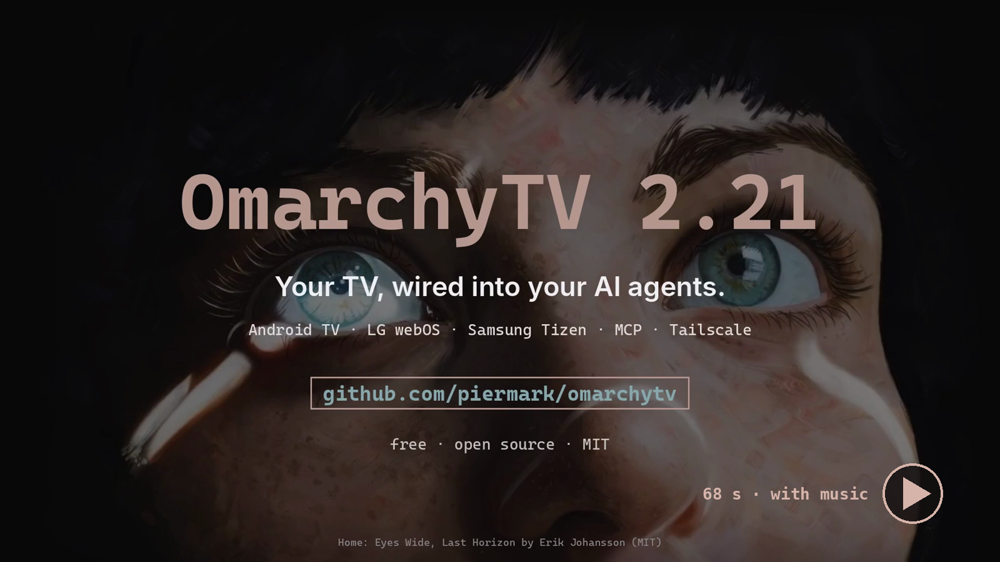

# What's new in OmarchyTV 2.21

**OmarchyTV becomes the screen of your agents and dashboards.** Here is what you can try in five minutes. Every
command runs on your paired Omarchy PC. On the TV, turn on Settings › Grok Bot & AI › **AI agent alerts while you watch** for
notifications and questions.

[](media/omarchytv-2.21.mp4)

*Click the picture for the 68-second video (MP4, 6 MB, with music).*

## Your agents talk to you on the TV

```sh
omarchy-link notify "Tests green" --from "Claude Code"              # waits while a film plays
omarchy-link notify --level alert --title Deploy "prod is down"     # shows at once
omarchy-link ask "Merge the PR?" --choice Merge --choice Wait       # you answer with the remote
claude mcp add omarchytv -- omarchy-link mcp                        # Claude Code gets every TV tool
```

```sh
omarchy-link watch -- make release                                  # ✓ / ✗ on the TV when it ends
omarchy-link notify --level alert --speak "prod is down"            # with a chime, read aloud
```

Hermes Agent: one `mcp_servers` entry and a skill ([examples/hermes.md](examples/hermes.md)). Ready-made hooks for
Claude Code and Codex, a GitHub Actions job that tells the TV when CI fails, Home Assistant
(doorbell → camera full screen, alert spoken aloud) and a dashboard page are in [examples/](examples/).

## Approve from the couch

```sh
omarchy-link agents approvals on      # Claude Code's "Allow this?" goes to the TV first
```

Allow, Deny or On the PC, with the remote. No answer means Claude Code asks as usual: nothing is allowed by itself.

## Your PC talks to the TV

```sh
omarchy-link hook add all                       # PC is up, Omarchy updated, battery low (spoken), font, theme
omarchy-link remind 20m "Pizza in the oven"     # said aloud on the TV at the time
omarchy-link room post hermes "Backup done"     # a pane on the Home with a room's last 5 lines
omarchy-link console                            # this tmux pane on the TV, read-only, until Ctrl+C
```

Agents get the same with the MCP tools `tv_room_post` and `tv_remind`.

## Dashboards on the TV, Hyprland style

```sh
omarchy-link pages add home "Home" http://192.168.1.20:8080/ --icon H --badge 2   # a tile on the Home
omarchy-link page http://192.168.1.20:8080/ http://192.168.1.21:3000/             # two pages tiled
```

1-4 or the colour keys switch windows, and BACK closes them. A page takes the TV's colours with one line of
JavaScript:

```html
<script src="http://<tv>:47800/v1/sdk/omarchytv.js"></script>
<script>OmarchyTV.connect({ token: "otva_…" }).followTheme(); OmarchyTV.remote();</script>
```

Make the token with `omarchy-link token add "Home" --scope read`, or on the TV in Settings › Connect Omarchy Linux › New app
token (shown as a QR code).

## From anywhere: Tailscale

Install the Tailscale app on the TV, then turn on Settings › Connect Omarchy Linux › Allow Tailscale (tailnet). On the PC:

```sh
omarchy-link tailscale on
omarchy-link discover
omarchy-link pair living-tv
```

Everything then works from the office or the beach house, over IPv4 and IPv6. For a machine elsewhere on the
tailnet, `omarchy-link token add "NAS" --scope notify --remote` prints its curl line, its `claude mcp add` command
and its Hermes block. On a 1-2 GB TV, `omarchy-link tv keepalive on` keeps it reachable right after a reboot. LG and Samsung need a Raspberry Pi as a bridge:
[TAILSCALE.md](TAILSCALE.md), [RASPBERRY-PI.md](RASPBERRY-PI.md).

## Agents in the cloud: Cloudflare Tunnel

```sh
omarchy-tv cloudflare setup omarchytv-mcp tv-mcp.example.com
omarchy-tv mcp --cloudflare omarchytv-mcp --access-team TEAM --access-aud AUD
```

A cloud agent can then read and talk to you, but not drive the TV, unless you allow it. The TV itself is never on
the internet. See [CLOUDFLARE.md](CLOUDFLARE.md).

## Quieter, lighter, fixed

- Home no longer starts music by itself. If you liked it, Radiomarchy › Settings › Music on Home brings it back.
- Radiomarchy has a sleep timer, and shows the song's page as a QR code for your phone.
- On LG, Radiomarchy no longer goes silent after the first song.
- Fractals are lighter: each scene is its own shader, and auto quality stops at "high".
- Home is Last Horizon "Eyes Wide" again (Erik Johansson's eyes, looping; a lighter copy on weak TVs). Only if you
  never picked a wallpaper: your choice stays, and the fractals are one click away in Settings › Wallpaper.
- Grok Bot diretto copes with ntfy.sh rate limits (#70). Grok Bot is built for Tom Ballard's Agent Desktop v0.3.3.
- LG and Samsung: Arrange panels really reorders the Home widgets, and every menu title follows the TV's language.
- On LG and Samsung, agents have their own key: an agent can never answer its own question.
- Install notes for Hisense, TCL, accessibility after updates and more: [INSTALL-TIPS.md](INSTALL-TIPS.md).
- Settings › System info shows the TV's state. On the PC, `omarchy-link tv logs` gives the log for bug reports,
  `tv backup` saves the TV's settings and `tv restore` puts them back.
- Eight community pull requests are merged. Thank you!

Guides: the [2.21 user guide](OMARCHYTV-2.21-GUIDE.md) (every switch and command), [remote access and AI
agents](REMOTE-AND-AI-GUIDE.md) (Tailscale, Cloudflare, MCP, Claude Code, Codex, Hermes), the developer reference
[INTEGRATIONS.md](INTEGRATIONS.md). The full list is in the [CHANGELOG](../CHANGELOG.md).
