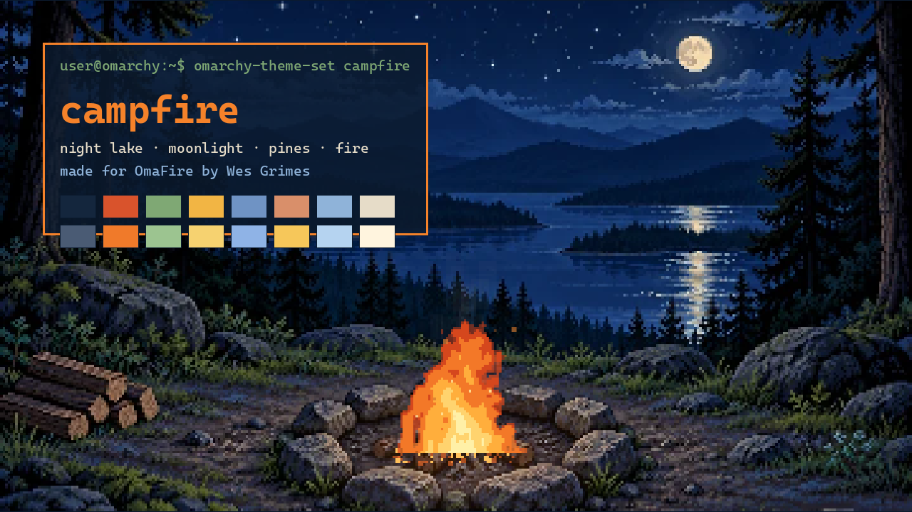

# Campfire — an Omarchy theme



A night by the lake: moonlight, pines and the fire. The palette is sampled from the scene of
[OmaFire](https://github.com/wesleygrimes/omafire) by Wes Grimes, and the wallpaper is a frame of his fire
burning in that scene. Made by [OmarchyTV](https://github.com/piermark/omarchytv); the same theme on the TV (Android TV, LG webOS,
Samsung Tizen), with OmaFire as the live wallpaper, is coming in the next OmarchyTV version.

## Install on your Omarchy PC

Tested on Omarchy 4.5 RC.

```
omarchy-theme-install https://github.com/piermark/omarchy-campfire-theme
```

Or by hand: copy this folder to `~/.config/omarchy/themes/campfire/`, then run

```
omarchy-theme-set campfire
```

(or pick **campfire** from Omarchy's theme menu).

## The fire burning on your desktop (once)

Omarchy wallpapers are still images, so the theme brings a 60-second loop of the fire and a small helper. Run once:

```
~/.config/omarchy/themes/campfire/extras/install-live
```

It installs `mpvpaper` (AUR, with yay), starts the fire behind your windows, and from then on it burns at every
login while the theme is **campfire**; pick another theme and it stops, come back and it burns again.

- With sound (the fire crackling and the night around the lake): `extras/install-live --sound` · back to silent:
  `extras/install-live --mute`
- Undo it all (the theme stays): `extras/install-live --remove`
- It is a 1800×1010 H.264 video, decoded by the GPU where it can: about 4 % of one CPU core and ~220 MB of memory on
  the PC it was tested on. It plays all the time, so check `btop` on an old PC.

The loop is drawn by OmaFire's own fire code and his sounds (crackle, embers, roar, crickets, frogs), cut so the end
flows into the start.

## What it themes

- `colors.toml`: the Omarchy palette (terminal, Waybar, Walker, Mako, Hyprlock and the rest through Omarchy's templates)
- `hyprland.conf`: the active window border burns from fire orange to embers
- `btop.theme`, `icons.theme` (Yaru), `backgrounds/01-campfire.png`, `preview.png`
- `extras/`: `campfire-loop.mp4`, `campfire-live` (the theme-set hook), `install-live`

On the TV, OmarchyTV shows the campfire as the live wallpaper of this theme; turn on
**Wallpaper → OmaFire sound** for the crackle and the night. OmaFire itself, the interactive campfire by
Wes Grimes for Omarchy, is here: https://github.com/wesleygrimes/omafire

## With OmarchyTV (next version, coming soon)

With omarchy-link paired, the TV and the PC follow each other: pick **campfire** on the PC and the TV switches
(and the other way round, with the TV switch "Also change the PC theme"). The TV's random wallpaper sometimes
brings the fire with this theme too.

## Credits and licence

- Theme: © 2026 Marco Porro ([x.com/MarcoPorro](https://x.com/MarcoPorro)), OmarchyTV, MIT.
- Scene, fire and sounds: OmaFire © 2026 Wes Grimes, MIT. The wallpaper is a frame of his `fire.js` drawing his
  `campsite-approved.webp`, cropped to 16:9 and scaled up without smoothing; `extras/campfire-loop.mp4` is 60 s of
  the same fire with his sounds mixed as his sound.js and night.js play them.

See [LICENSE](LICENSE).
